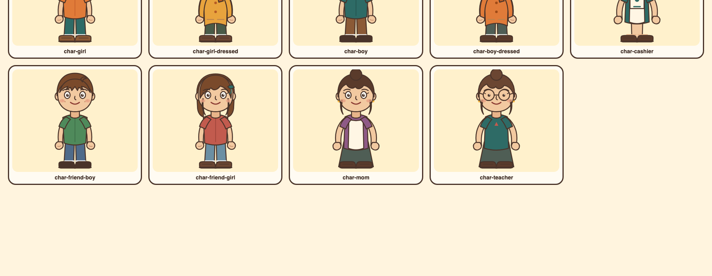
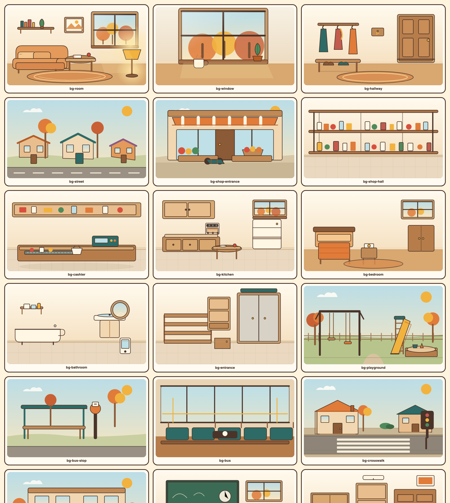
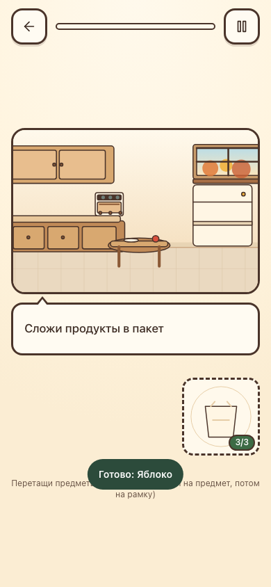

# Перерисовка персонажей и фонов

> Обновление от 23.11.2026. До него персонажи были собраны из кругов,
> треугольников и палок, обувь рисовалась отдельными прямоугольниками
> ниже ног, а фоны — из плоских прямоугольников без перспективы.

## Что изменилось

Перерисованы все 9 персонажей:

| Файл | Кто это |
|---|---|
| `char-girl` | девочка |
| `char-boy` | мальчик |
| `char-girl-dressed` | девочка в пальто и шарфе |
| `char-boy-dressed` | мальчик в пальто и шарфе |
| `char-friend-girl` | подруга |
| `char-friend-boy` | друг |
| `char-cashier` | кассир |
| `char-mom` | мама |
| `char-teacher` | учительница |

Новый рисунок:

- крупная голова с формой лица, ушами и шеей;
- волосы отдельными прядями, чёлка, заколка у девочки, вихор и веснушки у мальчика;
- глаза с белками, зрачками и бликами, брови, нос, улыбка, румянец;
- одежда с воротником, швами, пуговицами, манжетами;
- руки с ладонями и большим пальцем;
- ноги и обувь перекрываются: ботинки рисуются поверх штанин и юбки,
  поэтому ноги не отрываются;
- взрослые отличаются ростом, причёской, очками, фартуком и бейджем.

Персонажи больше не выглядят как геометрические заглушки: это рисованные
люди в тёплой палитре приложения, с крупными головами и простыми лицами —
в духе Gravity Falls, но без копирования конкретных героев.



## Фоны

Переписаны все 18 сцен в [`tools/backgrounds.py`](../tools/backgrounds.py):

- общая оболочка комнаты: стена с мягким градиентом, пол, плинтус, плитка;
- окно с рамой, стеклом, осенними деревьями и светом на полу;
- мебель с опорой на пол и тенями: диван, стол, кровать, шкаф, полки;
- кухня с плитой, холодильником, раковиной и столом;
- магазин: витрина, полки с товарами, касса, лента, пакет;
- улица, остановка, автобус, переход, школьный двор, класс, коридор;
- ванная с ванной, раковиной, зеркалом и нормальным туалетом;
- подъезд с лестницей, перилами и лифтом.

Главная правка композиции: сцена была 4:3, а фоны рисовались 16:9, поэтому
`object-fit: cover` обрезал бока — диван, лампа и дверь уезжали за кадр.
Теперь сцена 3:2, и фон виден целиком.



## Технически

- Новый модуль [`tools/characters.py`](../tools/characters.py): 9 функций и
  общие части (голова, руки, ноги, обувь, лицо, взрослый корпус).
- Новый модуль [`tools/backgrounds.py`](../tools/backgrounds.py): 18 сцен,
  общие `room_shell`, `window_unit`, `shadow`, `shelf`, `couch`.
- [`tools/make-art.py`](../tools/make-art.py) импортирует `CHARACTERS` и
  `BACKGROUNDS` и генерирует все SVG вместе с предметами и иконками.
- В движке появился класс `two-chars`: два персонажа в сцене разводятся
  влево и вправо, а не наезжают друг на друга.
- Класс взрослого персонажа переименован в `is-adult`: раньше он совпадал
  с классом панели «Взрослому» и получал её кремовый фон и рамку.
- Кэш service worker поднят до `asd-comm-v21`, потому что SVG кэшируются
  навсегда: иначе у уже установленной PWA остались бы старые картинки.
- Персонажи уменьшены с 82% до 68% высоты сцены: фон стал виден целиком,
  а не только стена за головой.
- Площадка и переход перерисованы отдельно: качели с двумя сиденьями,
  горка с лестницей, песочница, дома на земле и поперечная зебра вместо
  вертикальных палок.

## Перетаскивание

В drag-заданиях был баг: клон предмета (ghost) мог остаться на экране,
если палец отпускали вне элемента, а несколько быстрых перетаскиваний
плодили несколько клонов. Теперь:

- одновременно может быть только один ghost;
- при отпускании вне цели предмет возвращается на место с короткой
  анимацией, а не остаётся висеть;
- при смене шага, паузе и отмене все ghost удаляются;
- зона попадания в пакет увеличена на 22 px по краям, чтобы предмет
  засчитывался, даже если палец отпущен рядом с рамкой;
- проверено синтетическим перетаскиванием: 3 из 3 предметов, 0 ghost,
  счётчик `3/3`, возврат вне цели не меняет состояние.



## Как пересобрать

```bash
python3 tools/make-art.py              # все SVG + PNG-иконки
python3 tools/make-assets-manifest.py  # список для офлайн-кеша
bash tools/copy-web.sh                 # копия в Android-проект
```

## Где смотреть

- [Все персонажи](screens/characters-sheet.png)
- [Игра с девочкой](screens/game-390.png)
- [Игра с мальчиком](screens/game-boy-390.png)
- [Кассир и девочка в пальто](screens/game-drag-390.png)
- [Все 18 фонов](screens/backgrounds-sheet.png)
- [Мама в сцене завтрака](screens/school-mom-390.png)
- [Площадка](screens/game-playground-390.png)
- [Переход](screens/game-crosswalk-390.png)
- [Перетаскивание без дублей](screens/drag-fixed-390.png)

## Что осталось

- Аватары ребёнка — по-прежнему 12 эмодзи: это выбор ребёнка, а не иконки
  интерфейса.
- Позы персонажей статичные, руки опущены. Можно добавить 2–3 позы
  (машет, показывает, держит предмет) и выбирать их по шагу сценария.
- У фонов ещё нет мягких теней под персонажами и мебели на переднем плане;
  это следующий слой глубины, но уже не «кривые прямоугольники».
