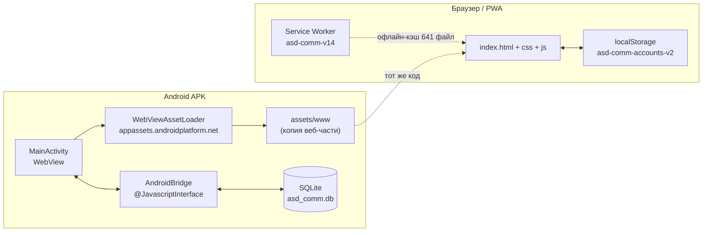
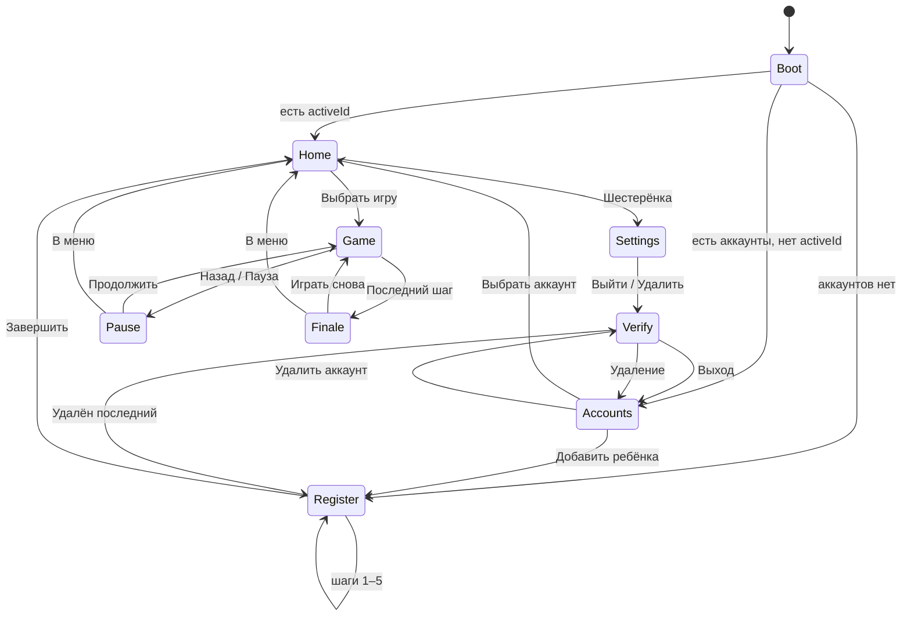
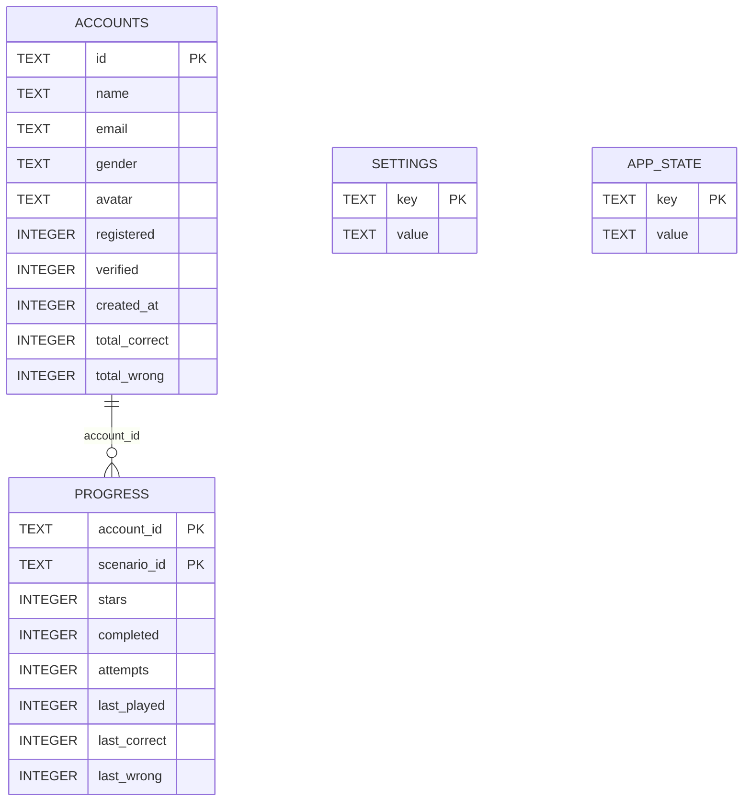
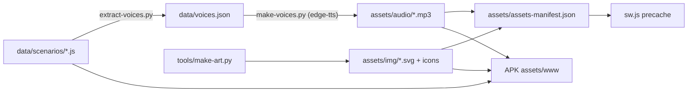

# Карта проекта «РАСигры»

> Состояние на 19.11.2026. Карта описывает то, что реально лежит в папке,
> а не только то, что заявлено в README. Источник истины — корень проекта;
> `android/app/src/main/assets/www/` — сгенерированная копия для APK.

## 1. Паспорт

| Параметр | Значение |
|---|---|
| Название | РАСигры (ASD-Comm-App) |
| Назначение | Пошаговые бытовые сценарии для тренировки коммуникации у детей с РАС |
| Аудитория | Дети (примерно 5–9 лет) и взрослый-сопровождающий |
| Язык | Русский, тексты зависят от пола ребёнка |
| Платформы | PWA в браузере; Android-приложение (Kotlin + WebView) |
| Офлайн | Да, полностью. Android не запрашивает `INTERNET` |
| Хранение | Браузер — `localStorage`; Android — SQLite `asd_comm.db` |
| Готовые сценарии | Магазин, Друг, Площадка, Школа (открываются по цепочке) |
| В разработке | Поликлиника, Кафе, День рождения (заглушки) |
| Стек | Vanilla HTML/CSS/JS, без сборщика и фреймворков; Kotlin 1.9, AGP 8.5 |
| Контент | 88 шагов сценариев, 493 реплики, 493 mp3, 148 SVG |

## 2. Два рантайма одной игры



Один и тот же интерфейс, два разных хранилища. `js/store.js` скрывает разницу:
если есть `window.AndroidDB`, читает и пишет в SQLite, иначе — в `localStorage`.
Поэтому все остальные модули не знают, где лежат данные.

## 3. Карта файлов

| Слой | Файлы | Роль | Руками? |
|---|---|---|---|
| Каркас | `index.html` | Все экраны и модалки в одном HTML | да |
| Стили | `css/styles.css` | Вся визуальная система, 857 строк | да |
| Состояние | `js/store.js` | Аккаунты, прогресс, настройки, миграция, два хранилища | да |
| Звук | `js/audio.js` | WebAudio-эффекты + mp3-озвучка + TTS-фолбэк | да |
| Каталог картинок | `js/assets.js` | Соответствие «ключ → SVG + эмодзи-фолбэк» | да |
| Движок | `js/engine.js` | Шаги, выбор, перетаскивание, звёзды, пауза | да |
| Приложение | `js/app.js` | Регистрация, экраны, аккаунты, настройки, финал | да |
| Сценарии | `data/scenarios/*.js` | Контент 4 игр; каждый файл кладёт себя в `window.SCENARIOS` | да |
| Реплики | `data/voices.json` | 493 текста, ключ = `<сценарий>.<id>` | генерируется |
| Картинки | `assets/img/*.svg` | 148 сцен, персонажей, предметов, жестов | генерируется |
| Озвучка | `assets/audio/*.mp3` | 493 файла, голос Svetlana | генерируется |
| Иконки | `assets/icons/*.png` | PWA/Android-иконки | генерируется |
| Офлайн-список | `assets/assets-manifest.json` | 641 файл для precache | генерируется |
| PWA | `sw.js`, `manifest.webmanifest` | Кэш, установка, офлайн | да |
| Android | `android/app/src/main/**` | WebView, мост, SQLite, ресурсы | да |
| Копия для APK | `android/app/src/main/assets/www/**` | Точная копия веб-части | генерируется |
| Сборка | `tools/build-android.sh`, `tools/copy-web.sh` | Копирование веб-части и Gradle | да |
| Генераторы | `tools/make-art.py`, `tools/characters.py`, `tools/backgrounds.py`, `make-voices.py`, `extract-voices.py`, `make-assets-manifest.py` | Контент-конвейер | да |
| Отладка | `tools/cdp.py` | CDP-клиент к WebView эмулятора | да |
| Документация | `README.md`, `docs/database.md`, `docs/schema.sql` | Описание и схема БД | да |

## 4. Карта экранов



| Экран | Что на нём | Данные |
|---|---|---|
| Регистрация, шаг 1 | Имя ребёнка, почта взрослого, демо-код | `reg`, `Store.createAccount` |
| Регистрация, шаг 2 | Код из письма, «открыть письмо», повтор | `reg.code` |
| Регистрация, шаг 3 | Девочка / мальчик | `reg.gender` |
| Регистрация, шаг 4 | 12 смайликов-аватаров | `reg.avatar` |
| Регистрация, шаг 5 | Итог знакомства, «Начать игру» | профиль |
| Кто играет | Список аккаунтов, звёзды, удаление | `Store.listAccounts()` |
| Главная | Аватар, имя, 7 карточек игр, статусы | `progress`, `isUnlocked` |
| Игра | Прогресс, сцена, реплика, варианты, панель взрослому | `Engine`, текущий шаг |
| Финал | Иллюстрация, звёзды, итог, две кнопки | `showFinale(result)` |
| Настройки | Аккаунт, 4 переключателя, выход/удаление/сброс | `settings` |
| Подтверждение | Код из письма для выхода/удаления | `verifyState` |
| Пауза | Продолжить / в меню | `Engine.pause/resume` |

### Статусы карточки игры

- `soon` — игра в разработке, серая, штриховка, бейдж «В разработке»;
- `locked` — предыдущая не пройдена, серая, бейдж «Закрыто»;
- `done` — пройдена, тёплый градиент, бейдж «Пройдено», звёзды;
- обычная — открыта, но ещё не пройдена.

## 5. Данные и инварианты

### Браузер

- Ключ: `asd-comm-accounts-v2`.
- Старый одиночный профиль `asd-comm-app-v1` мигрирует при первом чтении.
- Состояние: `{ activeId, settings, accounts: { id: { profile, progress, stats } } }`.

### Android / SQLite



Инварианты:

1. `progress` — составной ключ `(account_id, scenario_id)`; удаление аккаунта
   каскадно удаляет прогресс.
2. Настройки (`sound`, `voice`, `adult`, `animations`) общие для устройства.
3. `stars` — лучший результат, не уменьшается; `attempts` растёт.
4. `stats.correct/wrong` — накопительные за всё время.
5. Вход ищет аккаунт по паре «почта + имя» без учёта регистра, чтобы не плодить дубли.
6. `AndroidBridge.saveState()` при каждом сохранении перезаписывает всё состояние
   и удаляет строки, которых нет в присланном JSON.

## 6. Движок сценариев

Шаг — обычный объект:

```js
{
  type: 'pick' | 'info' | 'drag',
  scene: 'room', char: 'girl', char2: 'friendGirl',
  bubble: { id, text, boyText, boyId },
  speaker: '👩',
  adult: 'подсказка взрослому',
  options: [{ id, group, label }],
  correct: ['bread', 'milk'],
  single: false, cols: 3, shelf: false,
  hints: { bread: { id, text } },
  sayCorrect: { bread: { id, text } },
  bubbleByPending: { milk: { id, text } },
  next: 'label', branch: { id: 'label' },
  final: true,
  doneText, boyDoneText, boyAdult, nextLabel, dragHint,
  items: [], target: 'basket'
}
```

| Тип | Поведение |
|---|---|
| `pick` | Нужно выбрать все `correct`; ошибка не блокирует, но считается; правильные варианты гаснут |
| `info` | Одна кнопка «Дальше», без выбора |
| `drag` | Перетаскивание предметов в цель; работает и тап-тап; счётчик `0/N` |

- Прогресс-бар: `doneCount / totalSteps`; если `totalSteps` нет — `steps.length`.
- Звёзды: точность `correct / (correct + wrong)`; `≥ 0.85` — 3, `≥ 0.6` — 2, иначе 1.
- Пол: `boyText`/`boyId`, `boyDoneText`, `boyAdult`, `App.charKey()`.
- Озвучка: сначала mp3 по `id`, при ошибке — `speechSynthesis`; звуки — WebAudio.
- Пауза останавливает озвучку; выход из игры не сохраняет промежуточный результат.

## 7. Контент-конвейер



| Сценарий | Шагов | pick | info | drag | Реплик |
|---|---:|---:|---:|---:|---:|
| shop | 16 | 11 | 4 | 1 | — |
| friend | 20 | 12 | 5 | 3 | — |
| playground | 17 | 14 | 3 | 0 | — |
| school | 35 | 33 | 2 | 0 | — |
| **Всего** | **88** | **70** | **14** | **4** | **493** |

Добавление игры: создать `data/scenarios/<id>.js`, подключить в `index.html`
до `js/engine.js`, добавить запись в `SCENARIOS` в `js/app.js`, затем
`extract-voices.py` → `make-voices.py` → `make-assets-manifest.py` →
`copy-web.sh`.

## 8. Офлайн и PWA

- `sw.js` кэширует оболочку и все 641 файл из `assets-manifest.json` партиями по 40.
- Версия кэша задаётся руками: `const CACHE = 'asd-comm-v14'`.
- Оболочка: network-first с фолбэком на кэш; медиа: cache-first с фоновым обновлением.
- `manifest.webmanifest`: standalone, portrait, cream, 3 иконки.
- По `http://` (не localhost) service worker не работает — это ограничение браузера,
  а не приложения; для установки нужен HTTPS (Netlify/GitHub Pages).
- В Android service worker не нужен: файлы уже внутри APK.

## 9. Android-оболочка

- `MainActivity` — единственная Activity, портретная, без `INTERNET`.
- `WebViewAssetLoader` отдаёт `assets/www` по `https://appassets.androidplatform.net/assets/www/...`,
  поэтому работают относительные пути, `fetch` и `localStorage`.
- `AndroidBridge` — синхронные `getState()`, `saveState(json)`, `dbInfo()`, `exitApp()`.
- Системная «Назад» вызывает `window.androidBack()`: модалка → закрыть, игра → пауза,
  финал → меню, меню → выход.
- Release подписывается, если рядом с `android/` есть `keystore.properties`;
  иначе собирается неподписанный APK.

## 10. Сборка и запуск

| Задача | Команда |
|---|---|
| Быстрый запуск | `./start.command` или `python3 -m http.server 8765` |
| Скопировать веб в APK | `bash tools/copy-web.sh` |
| Debug APK | `bash tools/build-android.sh` |
| Release APK | `bash tools/build-android.sh release` |
| Установить на устройство | `bash tools/build-android.sh install` |
| Пересобрать озвучку | `python3 tools/extract-voices.py && python3 tools/make-voices.py` |
| Пересобрать картинки | `python3 tools/make-art.py` |
| Пересобрать офлайн-список | `python3 tools/make-assets-manifest.py` |
| Отладка WebView | `python3 tools/cdp.py eval "..."` |

Требования Android: JDK 21, Android SDK 34, Gradle wrapper. APK ≈ 15 МБ.

## 11. UI-система

| Токен | Значение | Комментарий |
|---|---|---|
| Фон | `#FFF4DE` + радиальный градиент | тёплая бумага |
| Поверхность | `#FFFBF2` | карточки |
| Приподнятая | `#FFF1CC` / `#FFE9C4` | пройденная игра / аватары |
| Текст | `#3B2A22` | 12.5:1 на фоне |
| Вторичный текст | `#6B5648` | 6.3:1 |
| Линия | `#4A342A` | 3px, фирменный контур |
| Акцент | `#E07B39` | тыква; текст на нём — `#2C1A12` (5.6:1) |
| Акцент тёмный | `#A94F16` | текст на светлом (5.0:1) |
| Семантика | `#3C6B45`, `#A8453A` | успех/опасность, 6.2:1 и 5.9:1 |
| Радиусы | 8 / 12 / 16 / 20 / 24 + pill | одна шкала |
| Тень | `0 4px 0 rgba(74,52,42,.18)` | «наклейка» |
| Шрифт | системный стек | без веб-шрифта |
| Начертания | 400 / 600 | иерархия размером и цветом |
| Иконки | инлайн-SVG 20px, stroke 1.8 | один набор, цвет текста |

Компоненты: `.btn` (primary/ghost/danger/wide), `.icon-btn`, `.scenario-card`,
`.option-card`, `.bubble`, `.adult`, `.modal-card`, `.switch-row`, `.field`,
`.gender-card`, `.avatar-opt`, `.account-card`, `.toast`, `.stars-row`.

Фирменный приём проекта — толстый чернильный контур + смещённая тень:
карточки выглядят как наклейки в детской книжке. Это осознанный язык, его
не надо заменять на «тонкие hairline» при полировке.

## 12. Риски и техдолг

| Приоритет | Что | Где | Почему важно |
|---|---|---|---|
| ✅ P0 | `db-line` была видна в браузере | `css/styles.css` | Исправлено: `[hidden] { display:none !important }` |
| ✅ P0 | Настройки обрезались на 360×640 | `css/styles.css` | Исправлено: `max-height: calc(100dvh - 32px)` + прокрутка |
| ✅ P1 | Не было `:focus-visible` | `css/styles.css` | Исправлено: контур 3px `--pine`, offset 3 |
| ✅ P1 | Был запрещён зум | `index.html` | Исправлено: `maximum-scale` и `user-scalable` убраны |
| ✅ P1 | Белый текст на акценте — 2.97:1 | `css/styles.css` | Исправлено: `#2C1A12` на `#E07B39` — 5.6:1 |
| ✅ P1 | Белый на зелёном — 4.10:1 | `css/styles.css` | Исправлено: зелёный `#3C6B45` — 6.2:1 |
| P2 | Дублирование веб-части в `android/.../www` | 14 МБ | после правок запускать `tools/copy-web.sh` |
| P1 | Нет focus trap в модалках | `js/app.js` | фокус ставится, но Tab может уйти за диалог |
| P2 | Нет скринридер-теста | — | axe/Lighthouse не подключены |
| P2 | `android/app/build` 128 МБ и `.gradle` 4.6 МБ в папке | — | раздувает сдачу/архив; нет `.gitignore` |
| P2 | Пароли подписи в README | `README.md:151–161` | учебные, но привычка плохая |
| P2 | Нет автотестов | — | 4 сценария проверяются вручную через CDP |
| P2 | `AppDatabase.onUpgrade` пустой | `AppDatabase.kt` | при смене схемы данные потеряются |
| P3 | `saveState` перезаписывает всё | `AndroidBridge.kt` | при росте данных будет медленно |
| P3 | Нет промежуточного сохранения игры | `engine.js` | закрыл приложение — прогресс шага потерян |
| P3 | Прогресс-бар считает `totalSteps`, а шагов больше | `data/scenarios/*.js` | бар доходит до 100% раньше конца |

## 13. Что уже проверено

- Debug и release APK собираются и запускаются на Android 14 (API 34).
- Все 4 сценария пройдены автотестом через CDP: 21/17/14/33 правильных, 0 ошибок.
- Мультиаккаунт, выход, удаление, каскад прогресса, кнопка «Назад», авиарежим.
- Озвучка и картинки лежат внутри APK; `INTERNET` не запрашивается.
- После unslop-полировки: дымовой прогон регистрации, магазина, паузы,
  выхода и экрана аккаунтов; скриншоты 390×844 и 360×640, JS-исключений нет.

## 14. Чего в проекте нет

- Ни одного автотеста в репозитории (только ручной `cdp.py`).
- Нет git-репозитория и `.gitignore`; папка уже весит 176 МБ.
- Нет CI, линтера, форматтера, проверки доступности.
- Нет локализации (только русский) и RTL.
- Нет экрана «прогресс ребёнка» для взрослого: статистика видна только в звёздах.
- Нет настоящей отправки письма: код показывается на экране (демо-режим).

## 15. Где смотреть результат

- Аудит и направление — [UNSLOP-AUDIT.md](UNSLOP-AUDIT.md).
- Отчёт по проходам — [UNSLOP-REPORT.md](UNSLOP-REPORT.md).
- Скриншоты — `docs/screens/`.
- Подбор скиллов и MCP — [TOOLING.md](TOOLING.md).
- Перерисовка персонажей и фонов — [ART-UPDATE.md](ART-UPDATE.md).
