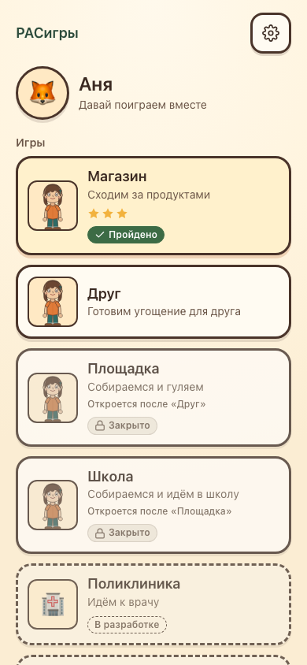
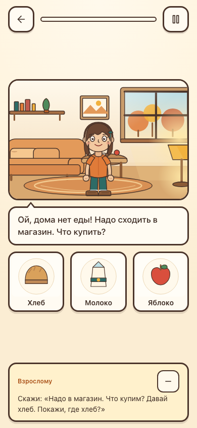
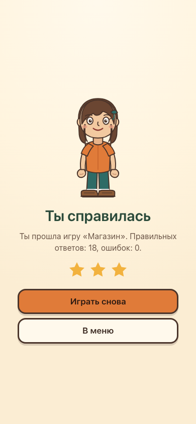
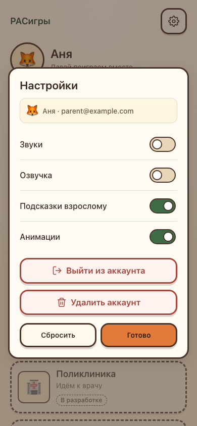
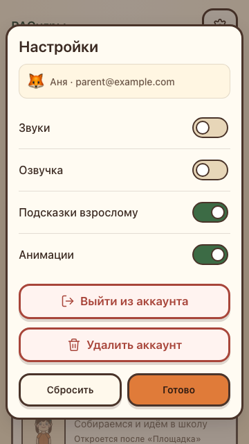
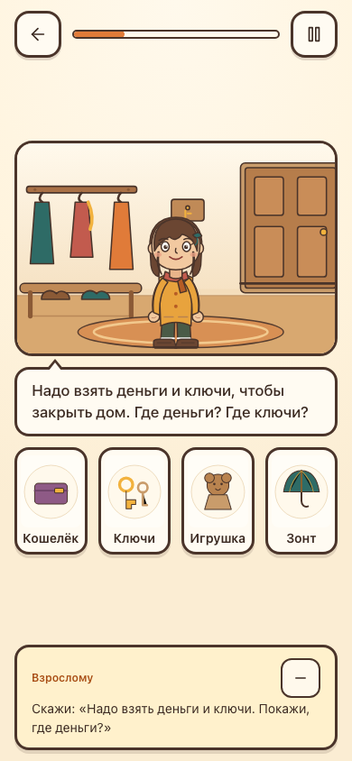
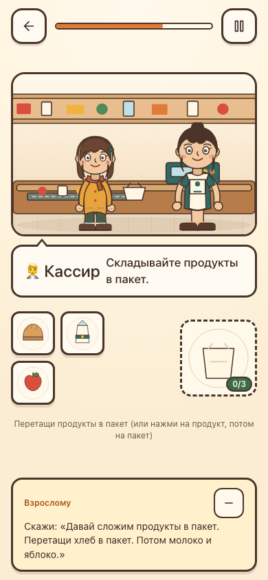
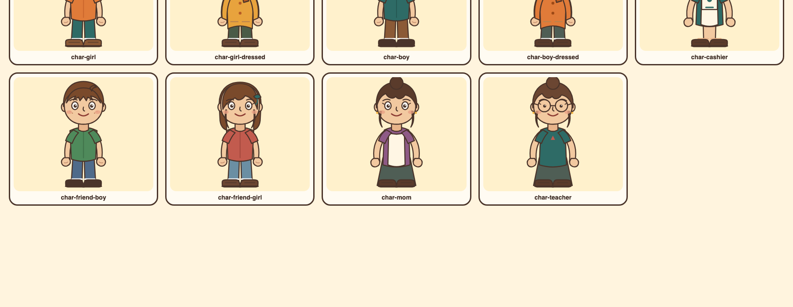

# Unslop-отчёт «РАСигры»

> Полировка по скиллу [unslop](https://github.com/heydamir/unslop)
> (CC BY 4.0, Damir Sokolovsky). Аудит и направление — в
> [UNSLOP-AUDIT.md](UNSLOP-AUDIT.md). Проектная карта — в
> [PROJECT-MAP.md](PROJECT-MAP.md). Перерисовка персонажей — в
> [ART-UPDATE.md](ART-UPDATE.md).

## Направление

- **Продукт.** Пошаговые бытовые истории, в которых ребёнок с РАС учится
  просить, выбирать и действовать в знакомом порядке, а взрослый рядом подсказывает.
- **Характер.** Тёплый, неторопливый, обстоятельный.
- **Мир.** Осенняя книжка-картинка и фетровая аппликация: бумага, охра,
  тыква, хвоя, мягкий свет из окна.
- **Моменты.** Иллюстрированная сцена шага и финал с персонажем и звёздами.
  Всё остальное — тихий хром.
- **Подпись.** Чернильный контур 3px + смещённая тень-«наклейка» только на
  интерактивных поверхностях.

## Что сделано по проходам

### 1. Отступы и сетка

- Шкала 4/8/12/16/20/24/32: страницы 20–24, карточки 12–16, панели 14–20.
- Одинаковые карточки получили одинаковый padding, ряды — один gap.
- Регистрация и экран аккаунтов центрируются по вертикали, а не оставляют
  пустую полосу внизу.
- В игре сцена, реплика и варианты собраны в один центрированный блок;
  на 360×640 он заполняет экран, на 390×844 — дышит сверху и снизу.
- Настройки больше не обрезаются: `max-height: calc(100dvh - 32px)` и прокрутка.

### 2. Цвет

- Убран оранжевый градиент и свечение у карточки «Пройдено»: теперь
  тёплая бумага `#FFF1CC` и спокойная смещённая тень.
- Убран градиент заливки прогресса — сплошной акцент.
- Белый текст на акценте заменён на `#2C1A12` (5.6:1).
- Зелёный и красный затемнены до `#3C6B45` (6.2:1) и `#A8453A` (5.9:1).
- Акцент остался один — тыква. Золото — только у звёзд, зелёный/красный —
  только у успеха/опасности.

### 3. Иконки

- Эмодзи в хроме заменены на инлайн-SVG из одного набора (18 символов):
  настройки, плюс, выход, удаление, питание, база, замок, галочка, игра,
  стрелка, пауза, минус, звезда, письмо, ребёнок, пользователи, смайлик, рука.
- Один размер 20px, stroke 1.8, цвет текста.
- Звёзды рейтинга — SVG, а не текстовые `★☆`; одинаково на всех платформах.
- Эмодзи остались там, где это контент: 12 аватаров, персонажи сцен,
  голоса в репликах (`🧒 Миша`, `👩 Мама`) и фолбэк картинок.

### 4. Копирайт

- Убраны восклицания из интерфейса: «Давай познакомимся», «Всё готово»,
  «Ты справилась».
- Приветствие-заголовок заменён именем: на главной «Аня», на финале
  регистрации «Миша».
- «ШАГ 1 ИЗ 5» → «Шаг 1 из 5», «ВЫБЕРИ ИГРУ» → «Игры»,
  «ВЗРОСЛОМУ» → «Взрослому», бейджи — sentence case.
- «Кто играет?» на шаге пола заменено на «Кто ты?» — больше не дублирует
  экран выбора аккаунта.
- «Ты прошла сценарий» → «Ты прошла игру».
- «Сбросить прогресс» → «Сбросить» (кнопка в настройках, подтверждение
  осталось).
- Реплики сценариев не менялись: это озвученный контент, а не интерфейс.

### 5. Типографика

- Веса 800/900/700 убраны: остались 400 и 600.
- Шкала 12/13/14/16/17/18/22/24/26/30.
- Иерархия — размером и цветом, а не жирностью.
- Отрицательный трекинг только у крупных заголовков; у мелкого текста 0.
- Системный шрифт сохранён: приложение офлайн, без веб-шрифта.

### 6. Раскладка

- Бейдж статуса больше не сжимает название и подзаголовок: он ушёл под
  мета-блок, в одну колонку с текстом.
- Звёзды показываются только у игр с результатом; у открытой, но не
  пройденной игры нет трёх пустых звёзд.
- Финал собран вокруг персонажа: герой, заголовок, итог, звёзды, две кнопки.
- Экран аккаунтов центрирован; карточка ребёнка, игра и удаление — в одной
  строке.

### 7. Детали

- Радиусы сведены к 8/12/16/20/24 + pill.
- Появился заметный `:focus-visible` (3px, отступ 3).
- Модалки получили `role="dialog"`, `aria-modal`, `aria-labelledby`;
  фокус ставится на первое действие.
- Прогресс анимируется через `transform: scaleX()`, получает
  `role="progressbar"` и `aria-valuenow`.
- Кнопка «свернуть» и удаление аккаунта — 44×44.
- Глобальное `[hidden] { display:none !important }` чинит служебную строку БД.
- Разрешён зум: убраны `maximum-scale` и `user-scalable=no`.

### 8. Визуалы

- SVG-сцены и персонажи сохранены — это и есть «момент» продукта.
- Плавающий 🎉 в финале убран; вместо него — персонаж ребёнка из тех же SVG.
- Новых картинок и генерации не потребовалось, промпт не писался.

### 9. Движение

- Убрана бесконечная анимация `floaty`.
- Остались только `pop` и `wobble` как обратная связь (0.3 s).
- Одна кривая `cubic-bezier(.22,1,.36,1)` и явные свойства переходов.
- `transition: all` заменён на `opacity`/`transform`.
- `prefers-reduced-motion` сохранён и распространяется на всё.

## Чек-лист

- [x] Направление записано, каждый проход ему следует
- [x] Отступы на 4px-шкале, одинаковые вещи одинаковы
- [x] Иконки, подписи и числа выровнены по колонкам
- [x] Один тёплый нейтральный ряд, три роли текста, один акцент
- [x] Нет градиентов между оттенками, свечений и цветных теней
- [x] Нет эмодзи в роли иконки интерфейса
- [x] Один набор иконок, один размер и штрих
- [x] Веса 400/600, без КАПС и трекинга у мелкого текста
- [x] Нет восклицаний и приветствия-заголовка в UI
- [x] Числа в одном формате, `tabular-nums` у метрик
- [x] Вложенные радиусы сведены к шкале
- [x] Кнопки и карточки используют общие радиусы
- [x] У героя есть настоящий визуал, а не заглушка
- [x] Первый экран собран целиком, без мёртвой полосы
- [x] Нет зацикленного движения, одна кривая
- [x] Фокус, зум и диалоги доступны
- [ ] Полный аудит скринридером (VoiceOver/TalkBack) — не входил в этот проход
- [ ] Focus trap в модалках — следующий шаг

## Скриншоты

| Главная | Игра | Финал |
|---|---|---|
|  |  |  |

| Настройки 390 | Настройки 360 | 4 варианта | Перетаскивание |
|---|---|---|---|
|  |  |  |  |

## Проверка

Скриншоты: `docs/screens/` — регистрация, главная, игра, финал, настройки
на 390×844 и 360×640.

Дымовой прогон в headless Chrome:

- регистрация с реальным демо-кодом;
- выбор пола и аватара, создание аккаунта;
- главная, карточки, звёзды, бейджи;
- магазин: выбор, правильный ответ, галочка, пауза;
- выход из аккаунта через код, возврат на экран «Кто играет?»;
- настройки на 360×640.

`Runtime.exceptionThrown` — 0. DOM-проверка на 390×844 и 360×640: нет
картинок без `alt`, кнопок без имени, дублей `id` и горизонтального
переполнения; все три модалки — `role="dialog"` с `aria-modal`; прогресс —
`role="progressbar"`; поля кода получили `aria-label`.

Полное прохождение всех четырёх сценариев после правок не гонялось:
это следующий шаг для Playwright / Mobile MCP. Веб-часть скопирована в
`android/app/src/main/assets/www` через `tools/copy-web.sh`; APK не
пересобирался.

## Что осталось за кадром

1. **Шрифт.** Системный стек оставлен, чтобы не тянуть веб-шрифт в офлайн.
   Если нужен характер — локальный Nunito (OFL) в `assets/fonts`, +2 файла
   и правка `CORE` в `sw.js`.
2. **Аватары.** 12 эмодзи — выбор ребёнка, поэтому оставлены. Можно позже
   нарисовать 12 SVG-мордочек в стиле иллюстраций.
3. **Онбординг.** Эмодзи-герои заменены на линейные иконки; если хочется
   теплее — поставить персонажа из `char-girl.svg`/`char-boy.svg`.
4. **Маршрут.** Пунктирная линия между играми могла бы усилить метафору
   прогулки, но это уже изменение раскладки, а не полировка.
5. **Focus trap** и полный аудит скринридером — отдельная задача доступности.
6. **Вложенные действия.** Карточка аккаунта — `role="button"` с кнопкой
   удаления внутри. Для полного аудита удаление лучше вынести из карточки
   или сделать отдельным меню.
