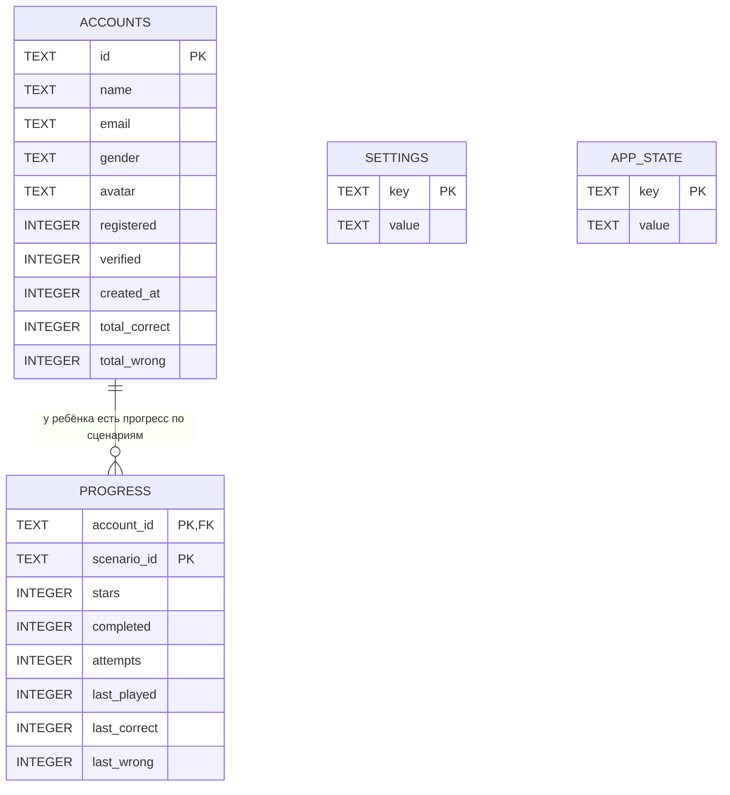

# База данных приложения «РАСигры»

Приложение хранит все данные **локально на устройстве** в базе данных
**SQLite 3** (файл `asd_comm.db`). База создаётся автоматически при первом
запуске приложения, интернет для работы не нужен.

- Файл базы: `/data/data/ru.asd.commgames/databases/asd_comm.db`
- Класс, создающий базу: `android/app/src/main/java/ru/asd/commgames/AppDatabase.kt`
- Класс-мост «JavaScript ↔ база»: `AndroidBridge.kt`
- Готовый SQL схемы: `docs/schema.sql`

## 1. Схема базы данных (ER-диаграмма)

```
        ┌───────────────────────────────┐
        │           accounts            │
        │  PK  id            TEXT       │
        ├───────────────────────────────┤
        │      name          TEXT       │
        │      email         TEXT       │
        │      gender        TEXT       │
        │      avatar        TEXT       │
        │      registered    INTEGER    │
        │      verified      INTEGER    │
        │      created_at    INTEGER    │
        │      total_correct INTEGER    │
        │      total_wrong   INTEGER    │
        └───────────────┬───────────────┘
                        │ 1
                        │
                        │  удаление аккаунта
                        │  удаляет его прогресс
                        │  (ON DELETE CASCADE)
                        │ N
        ┌───────────────▼───────────────┐        ┌───────────────────────────────┐
        │           progress            │        │           settings            │
        │  PK  account_id    TEXT  ─────┘        │  PK  key   TEXT               │
        │  PK  scenario_id   TEXT       │        ├───────────────────────────────┤
        ├───────────────────────────────┤        │      value TEXT               │
        │      stars         INTEGER    │        └───────────────────────────────┘
        │      completed     INTEGER    │          (общие для всего устройства)
        │      attempts      INTEGER    │
        │      last_played   INTEGER    │        ┌───────────────────────────────┐
        │      last_correct  INTEGER    │        │          app_state            │
        │      last_wrong    INTEGER    │        │  PK  key   TEXT               │
        └───────────────────────────────┘        ├───────────────────────────────┤
                                                 │      value TEXT               │
                                                 └───────────────────────────────┘
                                                   (id активного аккаунта)
```

То же самое в виде диаграммы «сущность — связь» (Mermaid, отображается на GitHub):



Связи:

| Связь | Тип | Правило |
|---|---|---|
| `accounts` → `progress` | один-ко-многим (1 : N) | `progress.account_id = accounts.id`; при удалении аккаунта его прогресс удаляется автоматически (`ON DELETE CASCADE`) |

## 2. Описание таблиц

### 2.1. Таблица `accounts` — аккаунты детей

Один аккаунт — один ребёнок. У каждого ребёнка свой прогресс и статистика,
поэтому в семье с двумя детьми создаётся два аккаунта.

| Поле | Тип | Ограничения | Назначение |
|---|---|---|---|
| `id` | TEXT | PRIMARY KEY NOT NULL | внутренний идентификатор, например `acc_lz3k1a_x9p2q` |
| `name` | TEXT | NOT NULL, по умолчанию `''` | имя ребёнка |
| `email` | TEXT | NOT NULL, по умолчанию `''` | почта взрослого — на неё «приходит» код подтверждения |
| `gender` | TEXT | NOT NULL, по умолчанию `'girl'` | `girl` или `boy`; влияет на картинки персонажа и окончания фраз |
| `avatar` | TEXT | NOT NULL, по умолчанию `''` | смайлик-аватар ребёнка, например `👧` |
| `registered` | INTEGER | NOT NULL, 0 или 1 | регистрация завершена |
| `verified` | INTEGER | NOT NULL, 0 или 1 | почта подтверждена кодом |
| `created_at` | INTEGER | NOT NULL | дата создания, миллисекунды Unix |
| `total_correct` | INTEGER | NOT NULL | всего правильных ответов за всё время |
| `total_wrong` | INTEGER | NOT NULL | всего ошибок за всё время |

### 2.2. Таблица `progress` — прогресс по сценариям

Одна запись — результат одного сценария у одного ребёнка.

| Поле | Тип | Ограничения | Назначение |
|---|---|---|---|
| `account_id` | TEXT | PRIMARY KEY, FOREIGN KEY → `accounts.id` | чей это прогресс |
| `scenario_id` | TEXT | PRIMARY KEY | код сценария: `shop`, `friend`, `playground`, `school` |
| `stars` | INTEGER | NOT NULL, 0…3 | лучший результат в звёздах |
| `completed` | INTEGER | NOT NULL, 0 или 1 | сценарий пройден до конца |
| `attempts` | INTEGER | NOT NULL | сколько раз проходили |
| `last_played` | INTEGER | NOT NULL | когда играли в последний раз |
| `last_correct` | INTEGER | NOT NULL | правильных ответов в последнем прохождении |
| `last_wrong` | INTEGER | NOT NULL | ошибок в последнем прохождении |

Первичный ключ составной (`account_id`, `scenario_id`) — это гарантирует,
что по одному сценарию у ребёнка ровно одна запись, и её можно обновлять.

### 2.3. Таблица `settings` — настройки устройства

Настройки общие для всех аккаунтов (звук, озвучка, подсказки взрослому,
анимации). Формат «ключ — значение» позволяет добавлять новые настройки,
не меняя структуру таблицы.

| Поле | Тип | Ограничения | Назначение |
|---|---|---|---|
| `key` | TEXT | PRIMARY KEY NOT NULL | `sound`, `voice`, `adult`, `animations` |
| `value` | TEXT | NOT NULL | `true` или `false` |

### 2.4. Таблица `app_state` — служебное состояние

| Поле | Тип | Ограничения | Назначение |
|---|---|---|---|
| `key` | TEXT | PRIMARY KEY NOT NULL | сейчас используется `active_account_id` |
| `value` | TEXT | | id аккаунта, который сейчас играет (может быть пусто) |

## 3. Нормализация

Схема приведена к **третьей нормальной форме (3НФ)**:

1. **1НФ** — все значения атомарны, повторяющихся групп нет. Вместо хранения
   всего прогресса одной строкой JSON он разложен по строкам таблицы `progress`.
2. **2НФ** — каждый неключевой атрибут зависит от всего первичного ключа.
   В `progress` ключ составной, но `stars`, `attempts` и остальные поля зависят
   именно от пары «ребёнок + сценарий», а не от её части.
3. **3НФ** — транзитивных зависимостей нет: данные ребёнка хранятся только
   в `accounts` и не дублируются в `progress` (там только ссылка `account_id`).

## 4. Как приложение работает с базой

Интерфейс приложения — это HTML/JS внутри WebView. Чтобы не переписывать
логику, между JavaScript и SQLite сделан **мост**:

```
  Экран (HTML/JS)  →  window.Store  →  window.AndroidDB  →  AndroidBridge.kt  →  SQLite
```

- `AndroidBridge.getState()` — читает таблицы и отдаёт состояние приложению;
- `AndroidBridge.saveState(json)` — в одной транзакции записывает изменения:
  обновляет строки `accounts` и `progress`, удаляет то, что удалил пользователь
  (удаление аккаунта автоматически убирает его прогресс за счёт `ON DELETE CASCADE`);
- `AndroidBridge.dbInfo()` — отдаёт сведения о базе (имя, версия, путь,
  количество строк в таблицах) — их видно в приложении в разделе «Настройки».

Если приложение открыто в обычном браузере (для отладки), тот же самый код
`window.Store` использует `localStorage` — логика приложения не меняется.

## 5. Проверка базы данных

Базу можно посмотреть прямо на устройстве или в эмуляторе:

```bash
# список таблиц и их структура
adb shell "run-as ru.asd.commgames sqlite3 databases/asd_comm.db '.tables'"
adb shell "run-as ru.asd.commgames sqlite3 databases/asd_comm.db '.schema accounts'"

# содержимое таблиц
adb shell "run-as ru.asd.commgames sqlite3 -header -column databases/asd_comm.db 'SELECT * FROM accounts;'"
adb shell "run-as ru.asd.commgames sqlite3 -header -column databases/asd_comm.db 'SELECT * FROM progress;'"

# копия базы на компьютер
adb exec-out "run-as ru.asd.commgames cat databases/asd_comm.db" > asd_comm.db
```

Кроме того, количество строк в таблицах показывается в самом приложении:
**Настройки (⚙) → строка «🗄 База данных»**.
